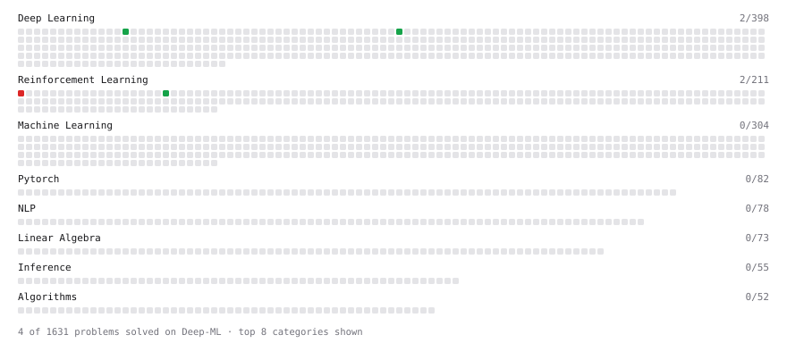

# Deep-ML

My machine learning practice from [Deep-ML](https://www.deep-ml.com). Every solution here was written by hand.

**4** solved · 4 problems · 0 labs · 0 math

[**Browse the interactive portfolio**](https://cr-gao.github.io/deep-ml/) to replay this filling in over time.

## Problems

| | Difficulty | Solved | |
| --- | --- | --- | --- |
| [Group Relative Advantage for GRPO](https://www.deep-ml.com/problems/224) | easy | 2026-10-10 | [solution](problems/0224-group-relative-advantage-for-grpo) |
| [Implement SwiGLU activation function](https://www.deep-ml.com/problems/156) | easy | 2026-10-10 | [solution](problems/0156-implement-swiglu-activation-function) |
| [KL Divergence Between Two Normal Distributions](https://www.deep-ml.com/problems/56) | easy | 2026-10-21 | [solution](problems/0056-kl-divergence-between-two-normal-distributions) |
| [Implement the GRPO Objective Function](https://www.deep-ml.com/problems/101) | hard | 2026-10-10 | [solution](problems/0101-implement-the-grpo-objective-function) |

---

_This file is regenerated by Deep-ML on every push._
